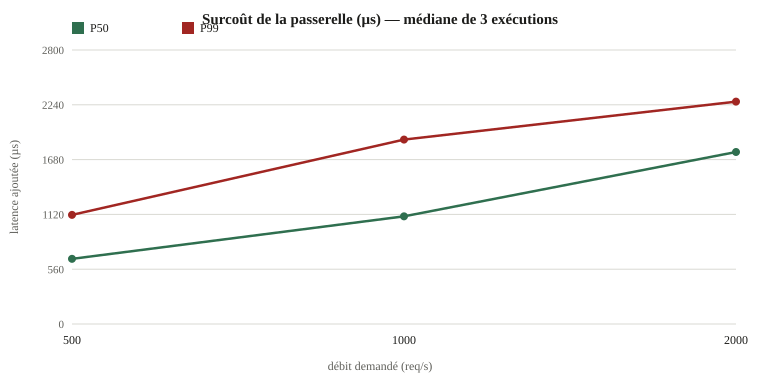

# Campagne de benchmark — 4 novembre 2026 (T1.26)

> **Première campagne publiée.** Elle mesure le surcoût de la passerelle et quelques métriques
> statiques sur **une seule machine de développement**. Ce n'est **pas** le protocole §11.2 du
> cahier (deux machines identiques + simulateur sur une troisième) : les chiffres servent de
> plancher reproductible et de suivi de régression, pas de preuve NFR contractuelle.



## Environnement

| Élément | Valeur |
| --- | --- |
| Système | Windows 11, x86-64 |
| CPU | 8 cœurs logiques |
| RAM | 32 Gio |
| Générateur | `oha` 1.16.0, boucle ouverte (`-q`), HDR |
| Compilation | `rustc 1.99.1`, profil release (`lto = "fat"`, `panic = "abort"`) |
| Topologie | générateur, simulateur et passerelle **colocalisés** |

## Protocole exécuté

1. Compilation des binaires release (`buntu-cli`, `buntu-mock-provider`).
2. Par exécution : démarrage du simulateur sur un port libre, mesure **directe** de
   `POST /v1/chat/completions`, puis démarrage de la passerelle routée vers ce simulateur
   (configuration générée) et mesure de la même requête via la passerelle.
3. Paliers **500, 1 000 et 2 000 req/s**, chauffe 3 s, palier 8 s, **3 exécutions**.
4. Publication de la **médiane** avec dispersion (min–max relatifs).

Commande exacte :

```sh
cargo xtask bench --runs 3 --qps 500,1000,2000 --seconds 8 --warmup 3 \
  --allow-variance --output benchmarks/results/2026-11-04-e6
```

## Surcoût de la passerelle

Surcoût = latence via la passerelle − latence directe vers le simulateur, mêmes requêtes, même
palier. Médiane des 3 exécutions ; dispersion = (max − min) / médiane.

| Débit demandé | P50 (µs) | P99 (µs) | Dispersion P50 | Dispersion P99 |
| --- | --- | --- | --- | --- |
| 500 req/s | 666 | 1 115 | 9 % | 27 % |
| 1 000 req/s | 1 100 | 1 885 | 15 % | 12 % |
| 2 000 req/s | 1 758 | 2 272 | 4 % | 25 % |

Lecture : le surcoût augmente avec le débit (saturation progressive du machine unique, simulateur
compris). Il inclut le saut TCP supplémentaire client → passerelle → simulateur et la traduction
canonique complète, ce que la cible NFR-PERF-1 (≤ 20 µs P50) suppose mesuré sur un banc dédié avec
fournisseur sur une autre machine.

## Métriques statiques

| Métrique | Valeur | Cible cahier | Verdict |
| --- | --- | --- | --- |
| Taille du binaire passerelle (UI incluse) | **4,5 Mio** | ≤ 40 Mio (NFR-PERF-11) | tenu |
| Démarrage à froid jusqu'à `/ready` (médiane) | **523 ms** | ≤ 200 ms (NFR-PERF-9) | non tenu en local |

Le démarrage à froid mesure processus → `/ready` (ouverture SQLite + migrations + configuration)
sur Windows. Une mesure Linux dédiée reste à faire dans la campagne multi-machines.

## Reproductibilité

Tolérance : 10 % d'écart relatif des P99 entre exécutions.

| Cible | Palier | P99 par exécution (ms) | Écart | Verdict |
| --- | --- | --- | --- | --- |
| simulateur | 500 | 1,78 / 1,11 / 1,70 | 60 % | échec |
| simulateur | 1 000 | 1,55 / 1,44 / 1,78 | 24 % | échec |
| simulateur | 2 000 | 2,19 / 2,24 / 2,26 | 3 % | ok |
| passerelle | 500 | 2,89 / 2,44 / 2,73 | 19 % | échec |
| passerelle | 1 000 | 3,51 / 3,18 / 3,67 | 15 % | échec |
| passerelle | 2 000 | 4,86 / 4,52 / 4,36 | 11 % | échec |

**Verdict : non reproductible au seuil de 10 %** sur 5 cellules sur 6, à cause de la colocation
(générateur, serveur, antivirus et synchronisation de fichiers sur les mêmes cœurs). La campagne
est publiée avec `--allow-variance`, la dispersion est reportée partout, et la reproduction
officielle passera par le banc §11.2 (deux machines + simulateur sur une troisième).

## Correspondance NFR-PERF

| NFR | Mesure | Statut |
| --- | --- | --- |
| NFR-PERF-1 (surcoût P50/P99 ≤ 20/100 µs à 5 000 req/s) | non mesuré au palier 5 000 ; surcoût local 0,7–2,3 ms | **hors protocole**, à refaire sur banc séparé |
| NFR-PERF-3 (≥ 20 000 req/s) | non mesuré (machine à 8 cœurs, générateur colocalisé) | à faire |
| NFR-PERF-5/6 (RSS) | non collecté sous Windows | à faire sous Linux |
| NFR-PERF-9 (démarrage ≤ 200 ms) | 523 ms local | **non tenu en local**, à revalider sous Linux |
| NFR-PERF-11 (binaire ≤ 40 Mo) | 4,5 Mio | tenu |

## Données brutes et reproduction

- Résultats complets : [`results.json`](../benchmarks/results/2026-11-04-e6/results.json)
- Rapport généré : [`report.md`](../benchmarks/results/2026-11-04-e6/report.md)
- Graphique : [`assets/bench-overhead.svg`](assets/bench-overhead.svg), régénéré par
  `node scripts/bench-chart.mjs benchmarks/results/2026-11-04-e6/results.json docs/assets/bench-overhead.svg`.

Toute publication de chiffres doit inclure ces fichiers bruts : aucune comparaison sans données.
